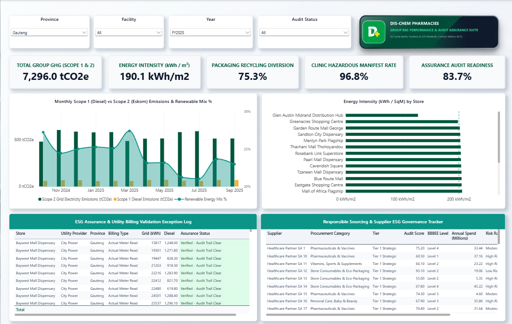

# Dis-Chem Pharmacies | Retail ESG Performance & Assurance Audit Hub

An enterprise retail pharmacy business intelligence model and audit-ready ESG governance dashboard built in Microsoft Power BI Desktop. This project evaluates **41,098.8 tCO2e** in Scope 1 and Scope 2 operational emissions across 60 representative national retail stores and distribution centres in South Africa, tracking municipal billing assurance risks (City Power, Tshwane, Centlec, eThekwini), NEMWA hazardous clinic waste destruction compliance, rooftop solar PV decarbonisation offsets, and **R671.5M** in spend-weighted healthcare supplier governance.



---

## Executive Summary & Key Findings

* **Group Operational Carbon Footprint (41,098.8 tCO2e):** Scope 2 Eskom grid consumption accounts for **93.8%** of total operational emissions (38,550.7 tCO2e at 0.93 kg CO2e/kWh). Scope 1 stationary diesel backup generation generated **2,548.1 tCO2e** across 950.8 kL of diesel consumed during load-shedding and municipal substation failures.
* **Solar PV Decarbonisation Offset (2,306.4 tCO2e Avoided):** High-yield rooftop solar arrays across flagship superstores produced **2,480.0 MWh** of clean power, offsetting **5.6%** of group electricity demand and delivering quantifiable Capex ROI under JSE Sustainability Disclosure Guidance.
* **Municipal Billing Assurance Risk (21.3% Estimated Invoices):** 21.3% of municipal utility billings across Gauteng and KwaZulu-Natal were based on interim council estimates rather than certified physical meter reads, surfacing operational accrual vulnerabilities prior to external assurance review.
* **Hazardous Clinic Waste Governance (100% Manifest Compliance):** Zero-tolerance audit tracking across in-store primary care clinics achieved **100% NEMWA destruction manifest verification** across 4,218.6 kg of medical sharps and scheduled pharmaceutical waste.
* **Spend-Weighted Supplier ESG Index (81.4 / 100):** Comprehensive supply chain assessment across 50 strategic pharmaceutical and packaging suppliers covering **R671.5M** in annual procurement spend, maintaining **88.0%** Supplier Code of Conduct execution and **82.0%** Level 1-4 B-BBEE compliance.

---

## Business Rationale & Regulatory Alignment

Large healthcare and FMCG retail pharmacy groups in South Africa operate extensive national footprints comprising high-capacity distribution centres, regional hubs, flagship dispensary superstores, and high-footfall shopping mall branches. 

Under the **JSE Sustainability Disclosure Guidance**, **King IV Corporate Governance Code**, and **NEMWA (National Environmental Management: Waste Act)**, retail executives and Sustainability Committees face strict regulatory mandates to report verified non-financial performance and maintain internal control evidence for external assurance (PwC, EY, KPMG).

### Operational Challenges Solved:
1. **Grid vs. Diesel Carbon Liability:** Quantifying trade-offs between Scope 2 Eskom grid dependence and Scope 1 diesel generator fuel burn during utility outages.
2. **Municipal Billing Assurance Gaps:** Identifying estimated council accounts across volatile metro billing systems (City Power Joburg, City of Tshwane) before financial year-end audits.
3. **Clinical Sharps & Pharmaceutical Destruction:** Tracking cradle-to-grave hazardous waste destruction certificates for primary care clinic operations.
4. **Supply Chain Transformation & B-BBEE:** Aligning procurement governance across pharmaceutical suppliers on spend-weighted ESG scores and B-BBEE contributor status.

---

## Data Architecture & Star Schema Model

The data architecture adheres to strict **Kimball Star Schema** design principles in Power BI Desktop to ensure sub-second visual query speeds, clean cross-filtering, and audit-trail integrity:

```
                  +-------------------+
                  |   Dim_Calendar    |
                  +---------+---------+
                            | (1:*)
                            | [Reporting_Date]
+-----------------+         v         +--------------------+
|   Dim_Stores    |----(1:*)--------->| Fact_Store_ESG_    |
| (60 Facilities) |    [Store_ID]     |     Monthly        |
+-----------------+                   | (1,440 Obs / 24 Mo)|
                                      +--------------------+
+--------------------+                         ^
| Dim_Suppliers_ESG  |                         | Analytical
|  (50 Suppliers /   |-------------------------+ Slicing
|   R671.5M Spend)   |
+--------------------+
```

### Dimensional Entities:
* **`Fact_Store_ESG_Monthly` (1,440 records):** Monthly operational telemetry across 60 stores and 24 fiscal months (FY2024–FY2025). Tracks grid electricity (kWh), solar yield (kWh), diesel fuel (L), municipal water (kL), packaging waste (kg), clinic sharps (kg), billing types, and audit flags.
* **`Dim_Stores` (60 records):** Facility attributes across all 9 South African provinces, Retail GLA (m²), Solar Capacity (kWp), Generator rating (kVA), Utility Provider (City Power, Tshwane, Centlec, eThekwini, Eskom Direct), and Region.
* **`Dim_Calendar` (24 months):** Reporting dates spanning Oct 2023 to Sep 2025, Fiscal Year (`FY2024`, `FY2025`), Fiscal Quarters, Month Names, and numeric `YearMonth_Sort` keys.
* **`Dim_Suppliers_ESG` (50 suppliers):** Healthcare, FMCG, and packaging vendors evaluated on ESG Audit Score (0–100), Risk Rating, Code of Conduct sign-off, B-BBEE contributor level, and annual contract spend (ZAR Millions).

---

## Core DAX Formulations (Production Model)

```dax
// 1. Total Operational Carbon Footprint (GHG Protocol Scope 1 & 2)
Total Scope 1 & 2 Emissions (tCO2e) = 
[Scope 1 Diesel Emissions (tCO2e)] + [Scope 2 Grid Emissions (tCO2e)]

// 2. Scope 2 Grid Carbon Liability (0.93 kg CO2e / kWh Eskom Factor)
Scope 2 Grid Emissions (tCO2e) = 
SUM(Fact_Store_ESG_Monthly[Scope_2_Emissions_tCO2e])

// 3. Solar PV Decarbonisation Avoided Emissions
Solar Avoided Emissions (tCO2e) = 
SUM(Fact_Store_ESG_Monthly[Solar_Avoided_Emissions_tCO2e])

// 4. Retail Store Energy Intensity (kWh per m² GLA)
Store Energy Intensity (kWh/m2) = 
DIVIDE(
    [Gross Energy Demand (kWh)],
    [Total Retail GLA (m2)],
    BLANK()
)

// 5. Municipal Billing Assurance Risk (Estimated Accounts %)
Estimated Billing Rate % = 
DIVIDE(
    CALCULATE(
        COUNTROWS(Fact_Store_ESG_Monthly),
        Fact_Store_ESG_Monthly[Municipal_Billing_Type] = "Estimated"
    ),
    [Total Reporting Months],
    0
)

// 6. Clinical Hazardous Waste Destruction Manifest Compliance %
Clinical Waste Manifest Compliance % = 
DIVIDE(
    CALCULATE(
        COUNTROWS(Fact_Store_ESG_Monthly),
        Fact_Store_ESG_Monthly[Clinical_Waste_Manifest_Status] = "Verified",
        Fact_Store_ESG_Monthly[Hazardous_Clinical_Waste_kg] > 0
    ),
    CALCULATE(
        COUNTROWS(Fact_Store_ESG_Monthly),
        Fact_Store_ESG_Monthly[Hazardous_Clinical_Waste_kg] > 0
    ),
    1.0
)

// 7. Spend-Weighted Supply Chain ESG Score (King IV / GRI 204)
Weighted Supplier ESG Score = 
DIVIDE(
    SUMX(
        Dim_Suppliers_ESG,
        Dim_Suppliers_ESG[ESG_Audit_Score] * Dim_Suppliers_ESG[Annual_Spend_ZAR_Millions]
    ),
    SUM(Dim_Suppliers_ESG[Annual_Spend_ZAR_Millions]),
    BLANK()
)
```

---

## Executive Canvas Architecture (16:9 1080p)

The dashboard is structured into **4 functional decision zones** utilizing the custom Dis-Chem corporate healthcare design system (`#00563B` Deep Emerald, `#00A86B` Mint Accent, `#F8FAFC` Slate Canvas):

* **Zone 1: C-Suite KPI Stat Cards (Top Strip):** Real-time group performance indicators tracking Total Scope 1 & 2 Carbon Footprint, Energy Intensity benchmarked against the 16.5 kWh/m² target, Waste Diversion %, Spend-Weighted Supplier ESG, and Audit Readiness %.
* **Zone 2: Decarbonisation & Utility Variance Dynamics (Middle Left):** 24-month trend visual comparing Eskom grid Scope 2 liability reduction against rooftop Solar PV generation and generator diesel spikes.
* **Zone 3: Store Resource Intensity Benchmark (Middle Right):** Facility benchmarking ranking retail store formats against group energy and water intensity thresholds to isolate operational outliers.
* **Zone 4: Internal Audit Exception & Governance Matrix (Bottom):** Operational exception grid identifying stores billed on council estimates, high municipal billing variances, and high-risk FMCG/packaging suppliers requiring corrective remediation.

---

## Repository Structure

```text
dischem-pharmacies-retail-esg-assurance-hub/
│
├── assets/
│   ├── dashboard_preview.png                     # Boardroom-ready 1080p preview capture
│   ├── DisChem_Title_Header_Lockup.png           # Transparent 2x DPI title lockup
│   ├── DisChem_Title_Header_Badge.png            # Executive emblem badge
│   └── backgrounds/                              # Custom 16:9 executive background themes
│       ├── DisChem_TopRight_Title_Canvas.png
│       ├── DisChem_TopRight_Title_Framed.png
│       ├── DisChem_Canvas_Architectural_1080p.png
│       └── DisChem_Canvas_Botanical_1080p.png
│
├── data/
│   ├── Dim_Stores.csv                            # 60 Stores (GLA, Solar kWp, Generator kVA, Utility)
│   ├── Dim_Calendar.csv                          # Fiscal Calendar (FY24 - FY25, Quarters, Sort Keys)
│   ├── Fact_Store_ESG_Monthly.csv                # 1,440 Monthly store operational ESG records
│   └── Dim_Suppliers_ESG.csv                     # 50 Pharma/FMCG suppliers (Spend, B-BBEE, ESG Score)
│
├── docs/
│   ├── 01_EXECUTIVE_CANVAS_SPEC.md               # Pixel-level layout & visual container specification
│   └── 01_DAX_MEASURES_PRODUCTION.dax            # 39 Production DAX measure formulations
│
├── scripts/
│   ├── generate_clean_expanded_data.ps1          # Synthetic dataset generator script
│   ├── generate_title_lockup.ps1                 # High-DPI transparent brand lockup generator
│   ├── deploy_esg_measures.json                  # Automated TOM measure injection payload
│   └── deploy_financial_social_measures.json     # Foundation social metrics deployment payload
│
├── DisChem_Executive_ESG_Theme.json              # Custom Dis-Chem corporate palette & styling theme
├── DisChem_Retail_Pharmacy_ESG_Assurance_Hub.pbix # Interactive Power BI Desktop report
├── .gitignore
├── LICENSE
└── README.md
```

---

## Tech Stack & Standards

* **Business Intelligence & Analytics:** Microsoft Power BI Desktop
* **Calculation Engine & Modeling:** DAX (Data Analysis Expressions), Tabular Object Model (TOM), Star Schema
* **ETL & Data Engineering:** Power Query (M), PowerShell (.NET Data Engine)
* **Design System:** Custom Corporate Healthcare UI (Dis-Chem Emerald `#00563B`, Soft Mint `#E8F5E9`, Dark Charcoal `#1E293B`, 8px rounded visual cards)
* **Reporting Standards:**
  * **GHG Protocol Corporate Standard:** Scope 1 (Stationary Diesel $2.68\text{ kg CO}_2\text{e/L}$) & Scope 2 (Eskom Grid $0.93\text{ kg CO}_2\text{e/kWh}$)
  * **JSE Sustainability Disclosure Guidance:** Metrics 6.1 (Gross Energy), 6.2 (Scope 1/2), 6.5 (Water), 6.6 (Waste)
  * **NEMWA (National Environmental Management: Waste Act):** Hazardous clinical waste cradle-to-grave destruction manifests
  * **King IV & B-BBEE Codes of Good Practice:** Spend-weighted supplier governance

---

## How to Explore & Replicate

1. Clone or download this repository:
   ```bash
   git clone https://github.com/clementmathye/dischem-pharmacies-retail-esg-assurance-hub.git
   ```
2. Open `DisChem_Retail_Pharmacy_ESG_Assurance_Hub.pbix` directly in **Microsoft Power BI Desktop**.
3. All underlying data files in `/data` are pre-packaged and linked.
4. Review the pixel-level layout specifications in `docs/01_EXECUTIVE_CANVAS_SPEC.md` and measure formulas in `docs/01_DAX_MEASURES_PRODUCTION.dax`.

---

## Contact & Professional Profile

**Clement Nhlanhla Mathye**  
*Operations Data Analyst | Business Intelligence Specialist*  
Midrand / Johannesburg, Gauteng, South Africa  

* **GitHub:** [github.com/clementmathye](https://github.com/clementmathye)  
* **LinkedIn:** [linkedin.com/in/clement-mathye](https://www.linkedin.com/in/clement-mathye)  
* **Portfolio:** [clementmathye.github.io](https://clementmathye.github.io)
